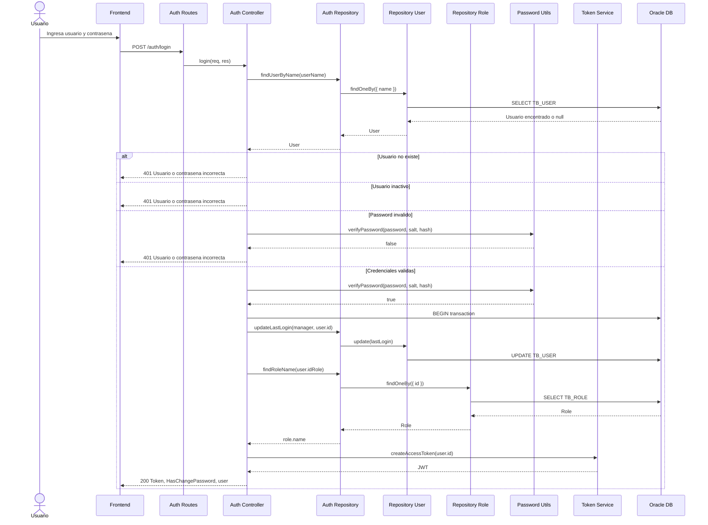
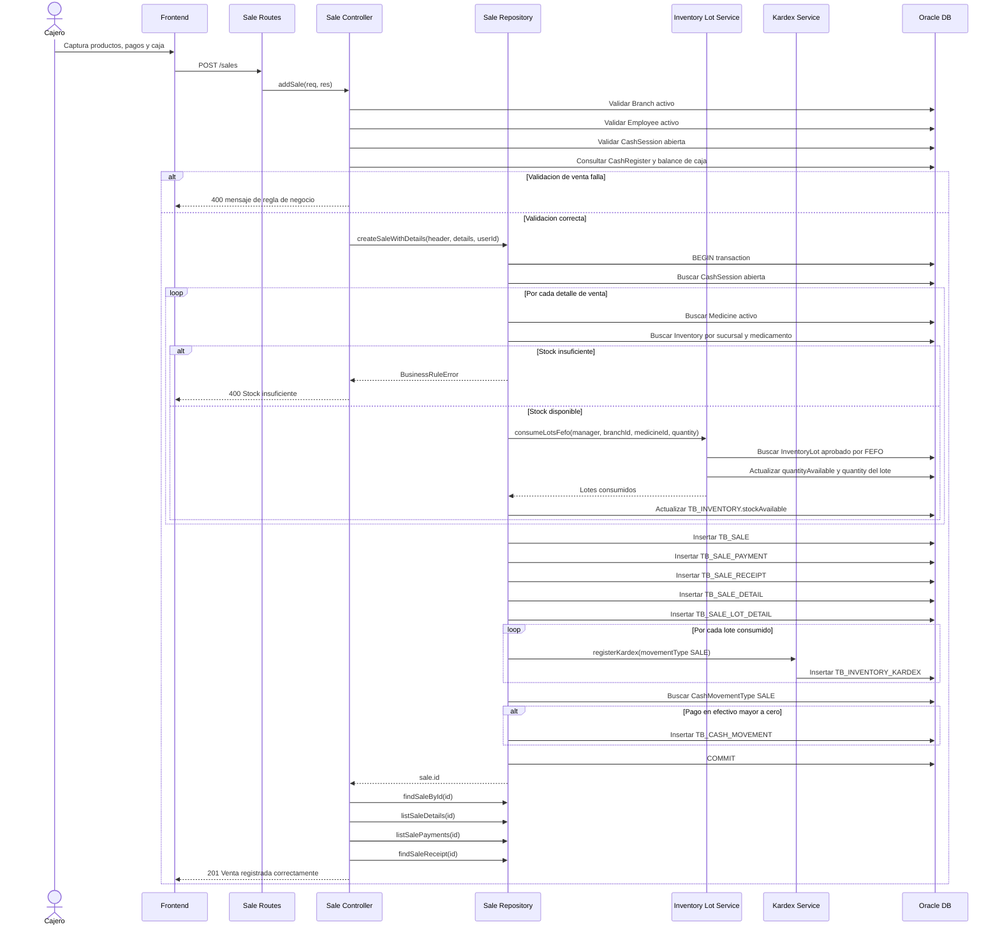
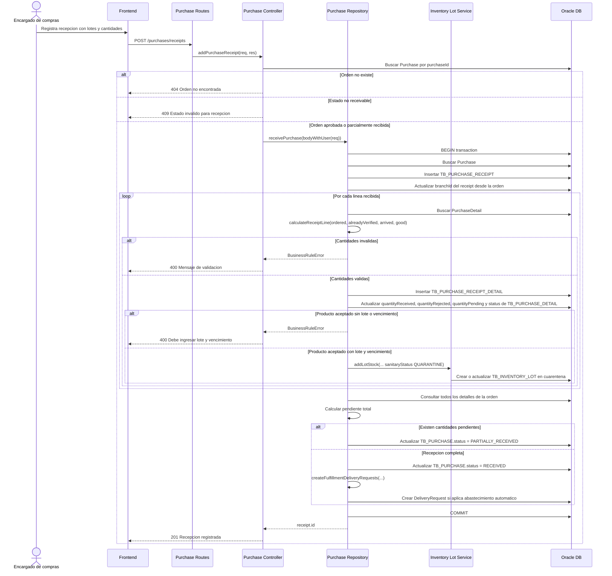

# Diagramas de Secuencia

Fuente: flujos reales del backend en `Core/src/modules`. Se documentan tres procesos principales porque el sistema contiene mas de tres procesos funcionales.

## 1. Inicio de sesion

Proceso basado en `auth.controller.js`, `auth.repository.js`, `password.js` y `token.service.js`.

## 2. Registro de venta presencial

Proceso basado en `sale.controller.js`, `sale.repository.js`, `inventory-lot.service.js` e `inventory-kardex.service.js`.

## 3. Recepcion de orden de compra

Proceso basado en `purchase.controller.js`, `purchase.repository.js` e `inventory-lot.service.js`.

## Procesos no detallados

El sistema contiene mas procesos funcionales, por ejemplo aprobacion de orden de compra, validacion tecnica de recepcion, factura de proveedor, pago de factura, devolucion a proveedor, pedidos de cliente, traspasos, caja, nomina y activos fijos. Por solicitud, este documento incluye solo tres diagramas.
