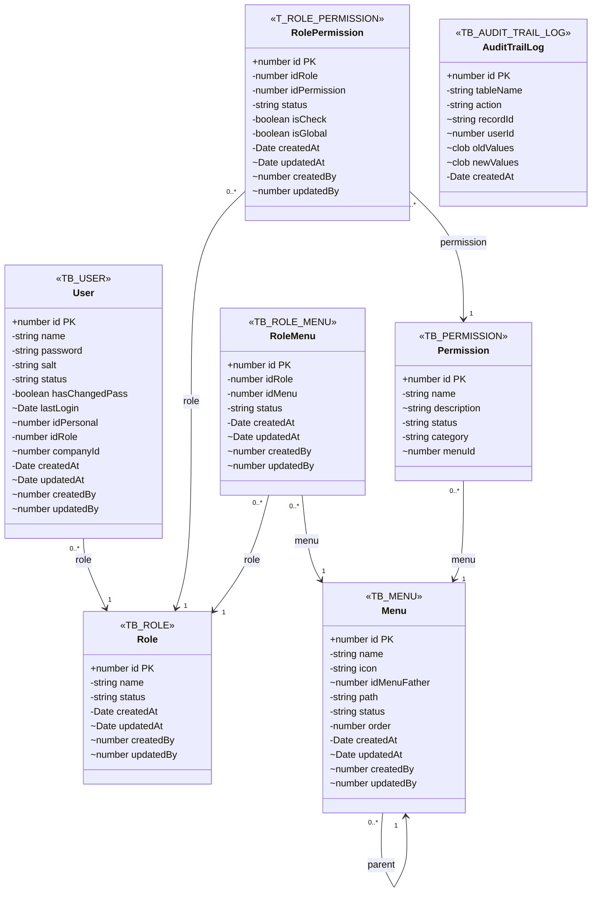
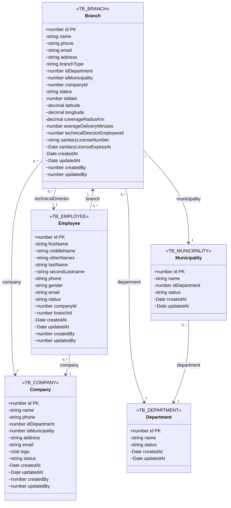
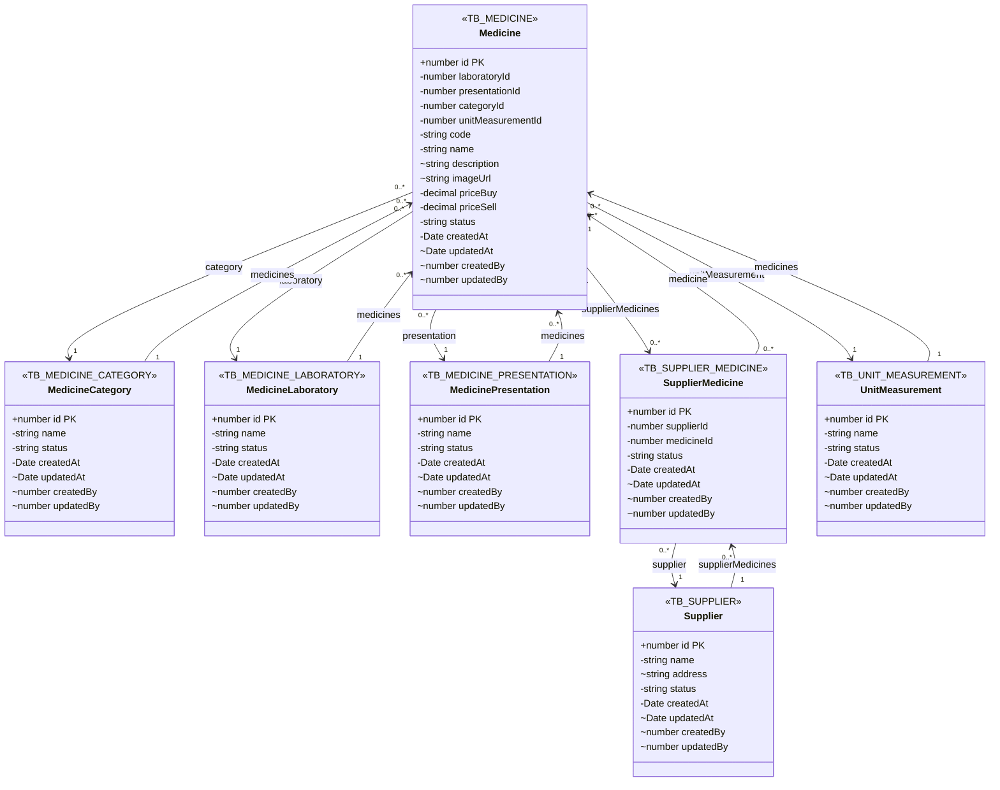
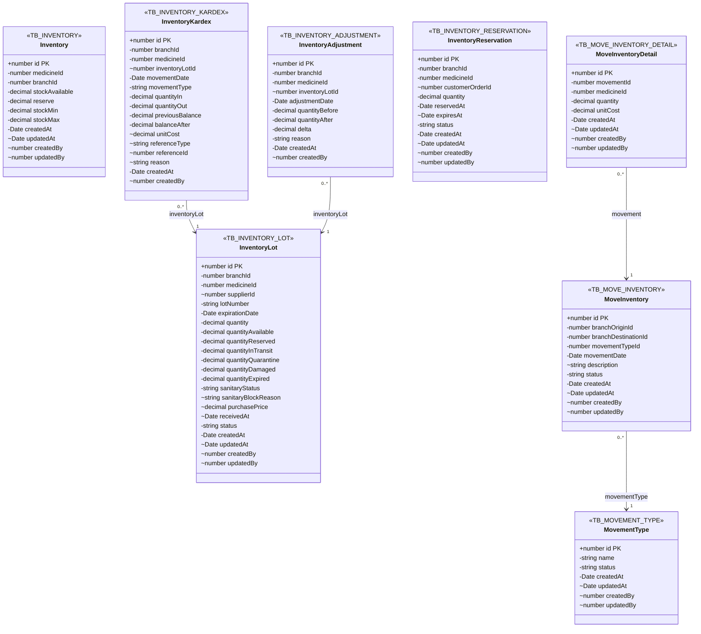
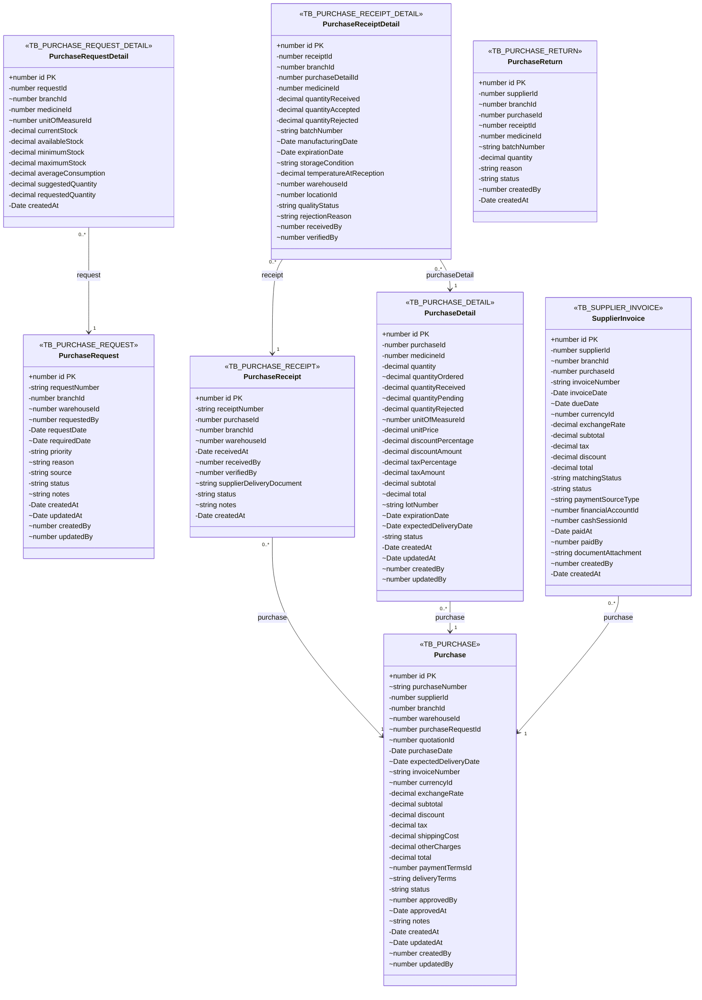
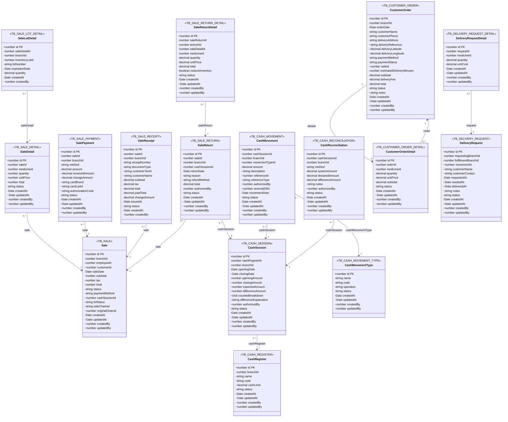
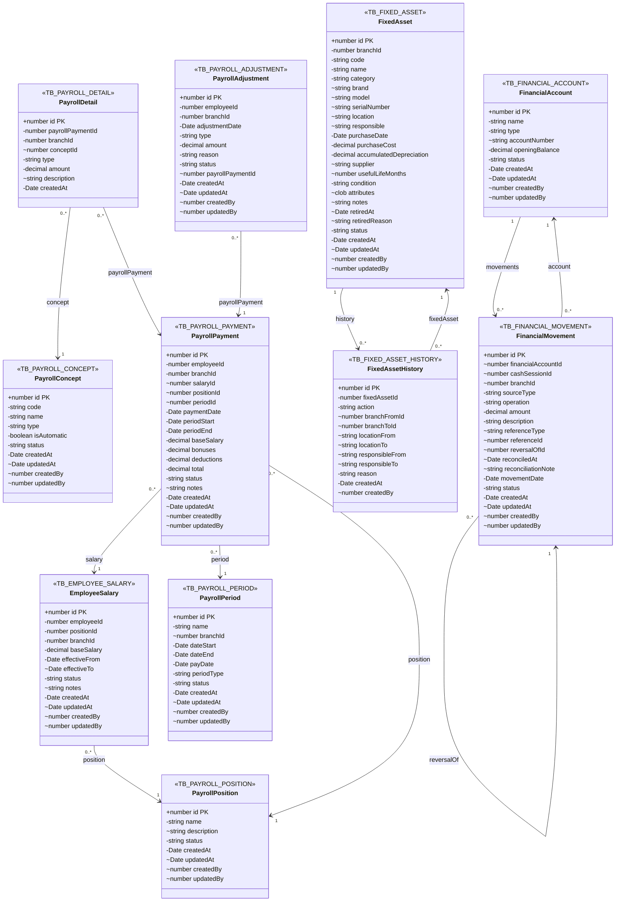

# Diagrama de Clases UML

Fuente: entidades TypeORM en `Core/src/entities` y tablas registradas en `Core/src/config/data-source.js`.

Convenciones: `+` primary key, `-` requerido, `~` nullable/opcional. El estereotipo de cada clase es la tabla Oracle real.

## Seguridad y Auditoria

## Empresa y Sucursales

## Catalogo Farmaceutico

## Inventario

## Compras y Recepcion

## Ventas Caja y Pedidos

## Nomina Activos y Tesoreria

## Relaciones Cross-Domain

```mermaid
classDiagram
  CashMovement "0..*" --> "1" Branch : branch
  CashReconciliation "0..*" --> "1" Branch : branch
  CashRegister "0..*" --> "1" Branch : branch
  CashSession "0..*" --> "1" Branch : branch
  CustomerOrder "0..*" --> "1" Branch : branch
  CustomerOrderDetail "0..*" --> "1" Medicine : medicine
  DeliveryRequest "0..*" --> "1" Branch : fulfillmentBranch
  DeliveryRequest "0..*" --> "1" Branch : requestingBranch
  DeliveryRequest "0..*" --> "1" MoveInventory : movement
  DeliveryRequestDetail "0..*" --> "1" Medicine : medicine
  EmployeeSalary "0..*" --> "1" Branch : branch
  EmployeeSalary "0..*" --> "1" Employee : employee
  FinancialMovement "0..*" --> "1" Branch : branch
  FinancialMovement "0..*" --> "1" CashSession : cashSession
  FixedAsset "0..*" --> "1" Branch : branch
  FixedAssetHistory "0..*" --> "1" Branch : branchFrom
  FixedAssetHistory "0..*" --> "1" Branch : branchTo
  Inventory "0..*" --> "1" Branch : branch
  Inventory "0..*" --> "1" Medicine : medicine
  InventoryAdjustment "0..*" --> "1" Branch : branch
  InventoryAdjustment "0..*" --> "1" Medicine : medicine
  InventoryKardex "0..*" --> "1" Branch : branch
  InventoryKardex "0..*" --> "1" Medicine : medicine
  InventoryLot "0..*" --> "1" Branch : branch
  InventoryLot "0..*" --> "1" Medicine : medicine
  InventoryLot "0..*" --> "1" Supplier : supplier
  InventoryReservation "0..*" --> "1" Branch : branch
  InventoryReservation "0..*" --> "1" CustomerOrder : customerOrder
  InventoryReservation "0..*" --> "1" Medicine : medicine
  MoveInventory "0..*" --> "1" Branch : branchDestination
  MoveInventory "0..*" --> "1" Branch : branchOrigin
  MoveInventoryDetail "0..*" --> "1" Medicine : medicine
  PayrollAdjustment "0..*" --> "1" Branch : branch
  PayrollAdjustment "0..*" --> "1" Employee : employee
  PayrollDetail "0..*" --> "1" Branch : branch
  PayrollPayment "0..*" --> "1" Branch : branch
  PayrollPayment "0..*" --> "1" Employee : employee
  PayrollPeriod "0..*" --> "1" Branch : branch
  Purchase "0..*" --> "1" Branch : branch
  Purchase "0..*" --> "1" Supplier : supplier
  PurchaseDetail "0..*" --> "1" Medicine : medicine
  PurchaseReceiptDetail "0..*" --> "1" Medicine : medicine
  PurchaseRequest "0..*" --> "1" Branch : branch
  PurchaseRequestDetail "0..*" --> "1" Medicine : medicine
  Sale "0..*" --> "1" Branch : branch
  Sale "0..*" --> "1" Employee : employee
  SaleDetail "0..*" --> "1" Medicine : medicine
  SaleLotDetail "0..*" --> "1" Branch : branch
  SaleLotDetail "0..*" --> "1" InventoryLot : inventoryLot
  SaleReceipt "0..*" --> "1" Branch : branch
  SaleReturn "0..*" --> "1" Branch : branch
  SaleReturnDetail "0..*" --> "1" Medicine : medicine
  SupplierInvoice "0..*" --> "1" Supplier : supplier
  User "1" --> "0..1" Employee : employee
```

## Trazabilidad Clase-Tabla

| Clase | Tabla | Atributos | Relaciones declaradas |
|---|---|---:|---:|
| AuditTrailLog | TB_AUDIT_TRAIL_LOG | 8 | 0 |
| Branch | TB_BRANCH | 22 | 4 |
| CashMovement | TB_CASH_MOVEMENT | 16 | 3 |
| CashMovementType | TB_CASH_MOVEMENT_TYPE | 9 | 0 |
| CashReconciliation | TB_CASH_RECONCILIATION | 14 | 2 |
| CashRegister | TB_CASH_REGISTER | 10 | 1 |
| CashSession | TB_CASH_SESSION | 17 | 2 |
| Company | TB_COMPANY | 13 | 0 |
| CustomerOrder | TB_CUSTOMER_ORDER | 22 | 2 |
| CustomerOrderDetail | TB_CUSTOMER_ORDER_DETAIL | 11 | 2 |
| DeliveryRequest | TB_DELIVERY_REQUEST | 15 | 3 |
| DeliveryRequestDetail | TB_DELIVERY_REQUEST_DETAIL | 9 | 2 |
| Department | TB_DEPARTMENT | 5 | 0 |
| Employee | TB_EMPLOYEE | 16 | 2 |
| EmployeeSalary | TB_EMPLOYEE_SALARY | 13 | 3 |
| FinancialAccount | TB_FINANCIAL_ACCOUNT | 10 | 1 |
| FinancialMovement | TB_FINANCIAL_MOVEMENT | 19 | 4 |
| FixedAsset | TB_FIXED_ASSET | 25 | 2 |
| FixedAssetHistory | TB_FIXED_ASSET_HISTORY | 12 | 3 |
| Inventory | TB_INVENTORY | 11 | 2 |
| InventoryAdjustment | TB_INVENTORY_ADJUSTMENT | 11 | 3 |
| InventoryKardex | TB_INVENTORY_KARDEX | 16 | 3 |
| InventoryLot | TB_INVENTORY_LOT | 22 | 3 |
| InventoryReservation | TB_INVENTORY_RESERVATION | 12 | 3 |
| Medicine | TB_MEDICINE | 16 | 5 |
| MedicineCategory | TB_MEDICINE_CATEGORY | 7 | 1 |
| MedicineLaboratory | TB_MEDICINE_LABORATORY | 7 | 1 |
| MedicinePresentation | TB_MEDICINE_PRESENTATION | 7 | 1 |
| Menu | TB_MENU | 11 | 1 |
| MoveInventory | TB_MOVE_INVENTORY | 11 | 3 |
| MoveInventoryDetail | TB_MOVE_INVENTORY_DETAIL | 9 | 2 |
| MovementType | TB_MOVEMENT_TYPE | 7 | 0 |
| Municipality | TB_MUNICIPALITY | 6 | 1 |
| PayrollAdjustment | TB_PAYROLL_ADJUSTMENT | 13 | 3 |
| PayrollConcept | TB_PAYROLL_CONCEPT | 10 | 0 |
| PayrollDetail | TB_PAYROLL_DETAIL | 8 | 3 |
| PayrollPayment | TB_PAYROLL_PAYMENT | 19 | 5 |
| PayrollPeriod | TB_PAYROLL_PERIOD | 12 | 1 |
| PayrollPosition | TB_PAYROLL_POSITION | 8 | 0 |
| Permission | TB_PERMISSION | 6 | 1 |
| Purchase | TB_PURCHASE | 28 | 2 |
| PurchaseDetail | TB_PURCHASE_DETAIL | 24 | 2 |
| PurchaseReceipt | TB_PURCHASE_RECEIPT | 12 | 1 |
| PurchaseReceiptDetail | TB_PURCHASE_RECEIPT_DETAIL | 19 | 3 |
| PurchaseRequest | TB_PURCHASE_REQUEST | 16 | 1 |
| PurchaseRequestDetail | TB_PURCHASE_REQUEST_DETAIL | 13 | 2 |
| PurchaseReturn | TB_PURCHASE_RETURN | 12 | 0 |
| Role | TB_ROLE | 7 | 0 |
| RoleMenu | TB_ROLE_MENU | 8 | 2 |
| RolePermission | T_ROLE_PERMISSION | 10 | 2 |
| Sale | TB_SALE | 18 | 2 |
| SaleDetail | TB_SALE_DETAIL | 11 | 2 |
| SaleLotDetail | TB_SALE_LOT_DETAIL | 9 | 3 |
| SalePayment | TB_SALE_PAYMENT | 15 | 1 |
| SaleReceipt | TB_SALE_RECEIPT | 16 | 2 |
| SaleReturn | TB_SALE_RETURN | 14 | 3 |
| SaleReturnDetail | TB_SALE_RETURN_DETAIL | 14 | 2 |
| Supplier | TB_SUPPLIER | 8 | 1 |
| SupplierInvoice | TB_SUPPLIER_INVOICE | 23 | 2 |
| SupplierMedicine | TB_SUPPLIER_MEDICINE | 8 | 2 |
| UnitMeasurement | TB_UNIT_MEASUREMENT | 7 | 1 |
| User | TB_USER | 14 | 2 |
