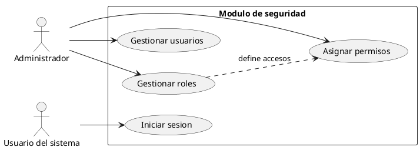
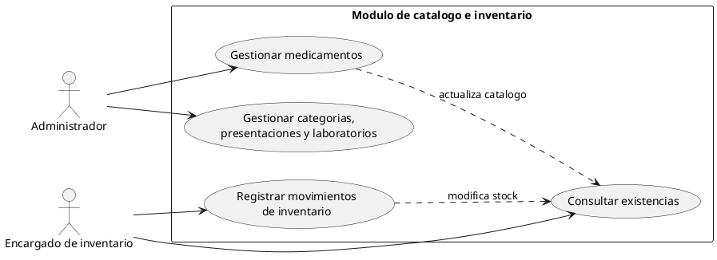
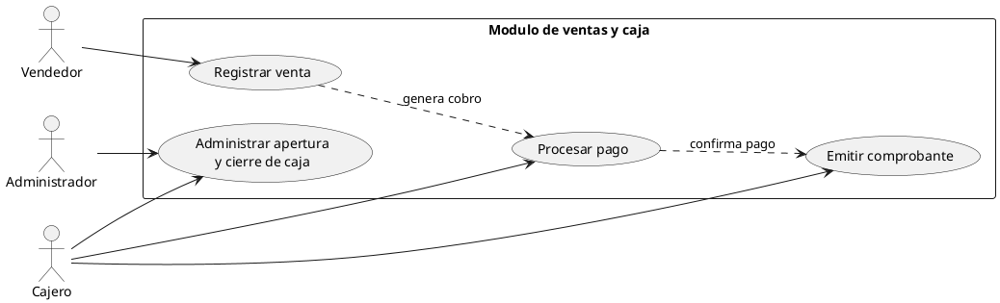
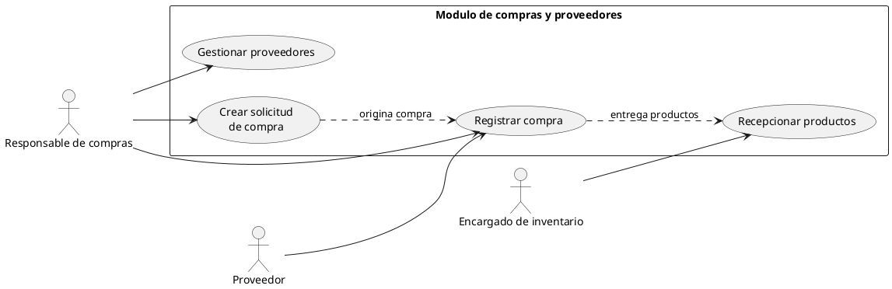

# Diagramas de casos de uso del sistema

Diagramas en sintaxis PlantUML compatible con draw.io.

## 1. Seguridad y administracion de usuarios

## 2. Catalogo e inventario

## 3. Ventas y caja

## 4. Compras y proveedores

