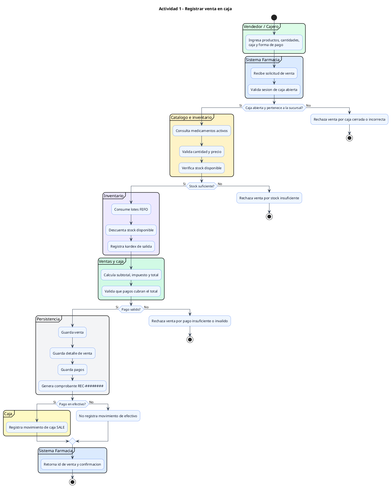
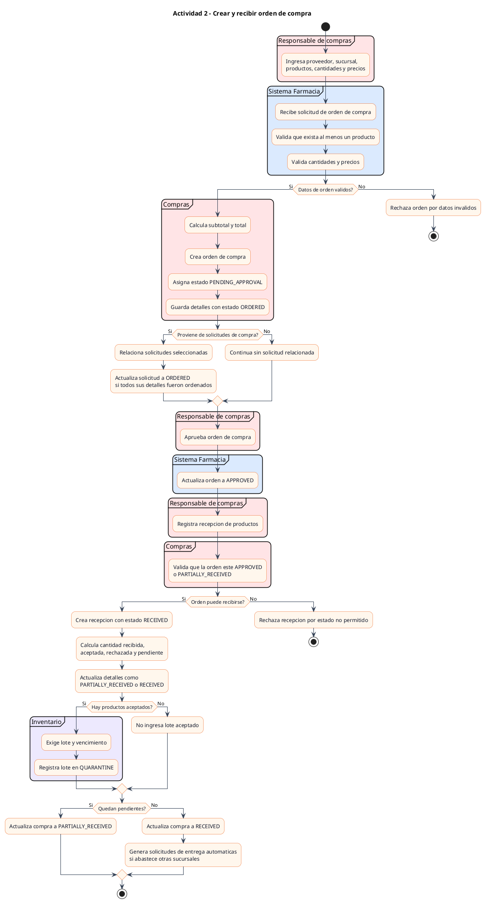
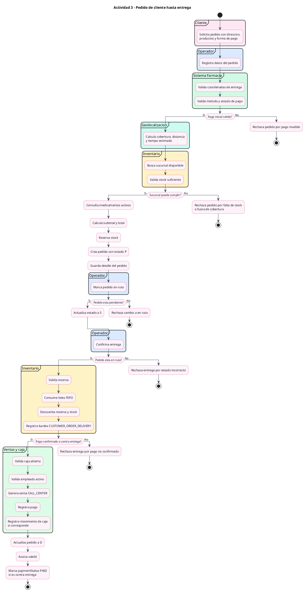
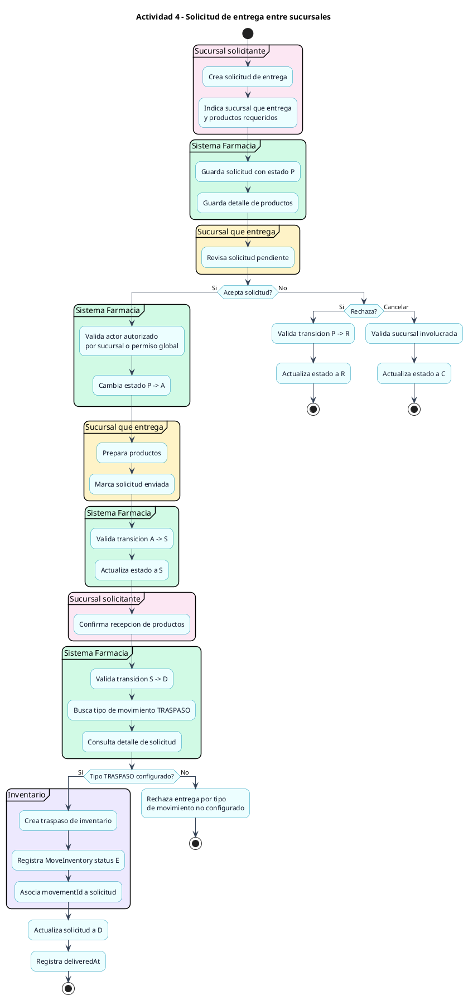

# Diagramas UML de actividades del sistema

Diagramas en sintaxis PlantUML compatible con draw.io. Cada diagrama representa el flujo de actividades de un proceso importante del sistema, basado en el codigo del backend.

## 1. Registrar venta en caja

Fuente principal: `Core/src/modules/catalog/sales/sale.repository.js`.

## 2. Crear y recibir orden de compra

Fuente principal: `Core/src/modules/catalog/purchases/purchase.repository.js`.

## 3. Pedido de cliente hasta entrega

Fuente principal: `Core/src/modules/catalog/customer-orders/customer-order.repository.js`.

## 4. Solicitud de entrega entre sucursales

Fuente principal: `Core/src/modules/catalog/delivery-requests/delivery-request.repository.js`.

