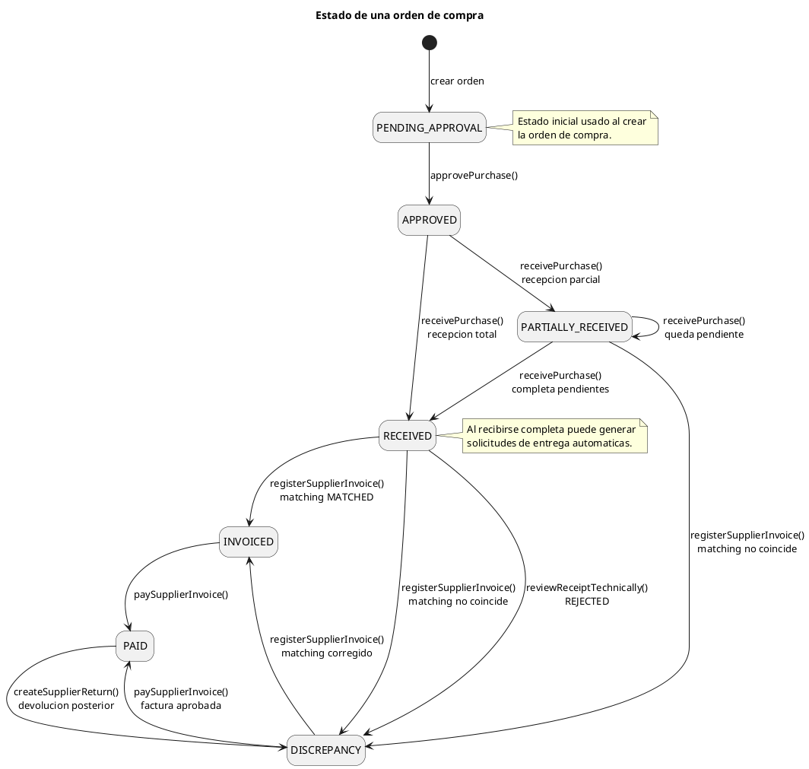
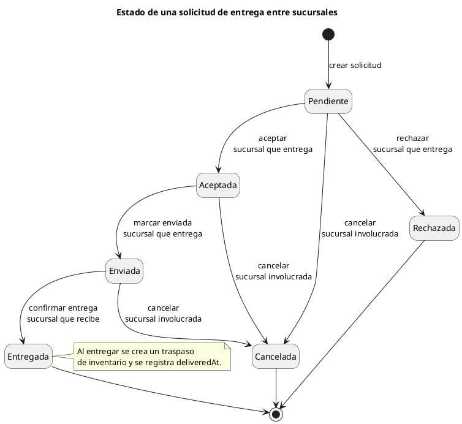
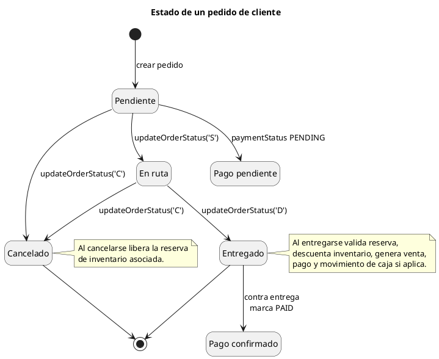
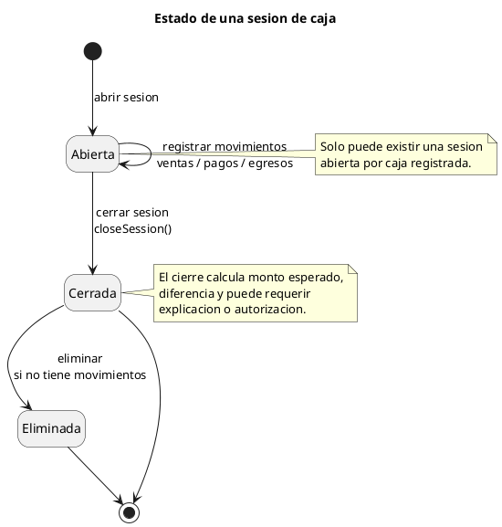

# Diagramas de estados del sistema

Diagramas en sintaxis PlantUML compatible con draw.io. Estan basados en estados y transiciones definidas en el codigo del backend.

## 1. Modulo de compras

Fuente principal: `Core/src/modules/catalog/purchases/purchase.repository.js`.

## 2. Modulo de solicitudes de entrega

Fuente principal: `Core/src/modules/catalog/delivery-requests/delivery-request.repository.js`.

## 3. Modulo de pedidos de cliente

Fuente principal: `Core/src/modules/catalog/customer-orders/customer-order.repository.js`.

## 4. Modulo de caja

Fuente principal: `Core/src/modules/catalog/cash/cash-session.controller.js` y `cash-session.repository.js`.

